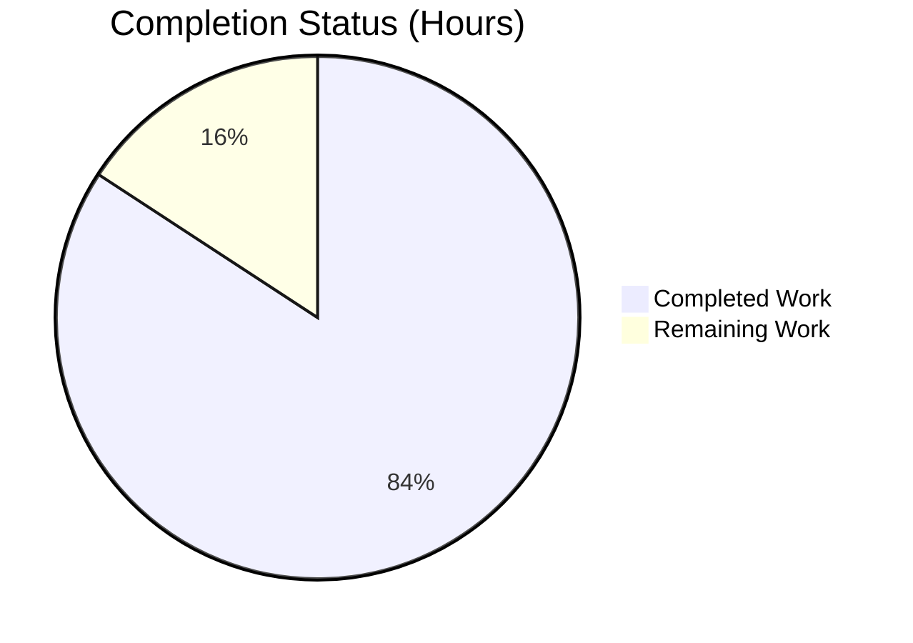
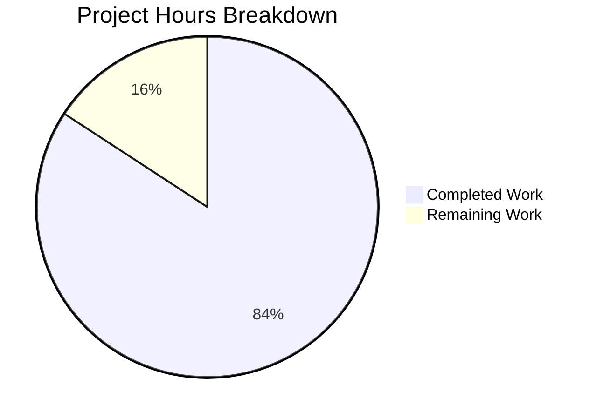
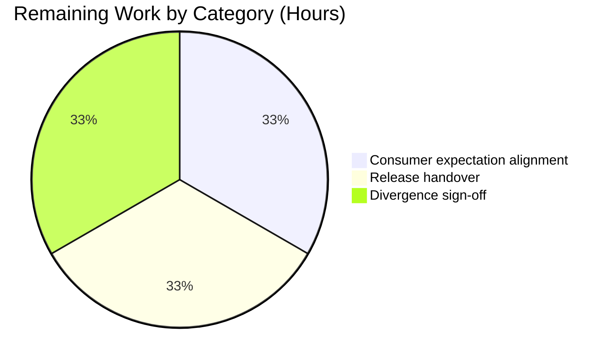

# 1. Executive Summary

## 1.1 Project Overview

This project is a single-file Node.js console program that writes the plain line `Welcome to Blitzy` to standard output, with the four-line `README.md` the request specifies and nothing else. It serves a developer running one command in a terminal, and any automated check of that exact line. Its value is a deterministic, dependency-free proof the product prints correctly: zero dependencies, zero configuration, no build step, no service to operate. The deliverable is two files at the repository root — `index.js` (one `console.log` statement under a one-line JSDoc summary; 2 lines, 69 bytes) and `README.md` (4 lines, 97 bytes) — run with `node index.js` on Node.js v22.23.3.

## 1.2 Completion Status



**84% complete** — Completed: **Dark Blue #5B39F3** · Remaining: **White #FFFFFF**

| Metric | Value |
|---|---|
| Total Hours | 9.5 |
| Completed Hours (AI + Manual) | 8.0 |
| Remaining Hours | 1.5 |

Calculation: 8.0 ÷ 9.5 × 100 = **84%**. Every requirement the two files carry is met; what remains is handover.

## 1.3 Key Accomplishments

- [x] `index.js` prints exactly `Welcome to Blitzy` — 18 bytes
- [x] Output is unformatted: no colour, escape, quote, padding, bullet or prefix
- [x] Nothing is written to standard error; the process exits 0
- [x] Output is byte-for-byte identical on every run, in any locale, under a scrubbed environment
- [x] The program takes no input, argument or configuration, and depends on nothing
- [x] `README.md` states the printed text and run command in four lines, with no excluded section
- [x] The repository holds only the two planned files — no manifest, lockfile, dependency, test artefact or CI
- [x] The documented run works from a fresh clone and as a non-root user

## 1.4 Critical Unresolved Issues

No requirement is unresolved: **0 of 30** scoped requirements remain open. Four handover items remain, none affecting behaviour.

| Issue | Impact | Owner | ETA |
|---|---|---|---|
| Regression protection lives outside the repository by design (no test suite, manifest or CI may be added) | A future edit to the printed line is caught only by the documented byte-exact gate | Repository owner | Accepted with caveat |
| Downstream byte-count expectation unconfirmed (the line is 17 characters plus one newline = 18 bytes) | A consumer asserting a different byte count would fail against a correct program | Integration owner | 1 day |
| Release packaging must be taken from the commit, not the working directory | Two empty untracked capture directories at the root would otherwise ship as paths | Release engineer | 1 day |
| Sign-off of the three recorded divergences (README delivered as an update; the readme against the no-other-file rule; the overridden verification-section rule) | No code change follows from any of them; the decision is administrative | Repository owner | 1 day |

## 1.5 Access Issues

No access issues identified: the program needs no credential, service, database or third-party access, no environment variable and no network connection.

## 1.6 Recommended Next Steps

1. **[High]** Confirm the exact output (18 bytes on stdout, empty stderr, exit 0) with every consumer.
2. **[Medium]** Package the release from the commit so only the two tracked files ship.
3. **[Medium]** Keep the byte-exact gate as the check on any change to `index.js`.
4. **[Low]** Record the sign-off decision on the three divergences.
5. **[Low]** Hold `README.md` to its five-line cap; it currently uses four.

# 2. Project Hours Breakdown

## 2.1 Completed Work Detail

| Component | Hours | Description |
|---|---|---|
| Program — `index.js` | 1.0 | The single `console.log` statement under a one-line JSDoc summary, byte-exact to the required contents; delivers the printed line, its unformatted form and the minimal footprint |
| Documentation — `README.md` | 0.5 | Four lines stating the printed text and the one command that runs it, within the five-line cap and with none of the excluded sections |
| Runtime verification | 3.0 | Byte composition and stream separation, exit status, determinism, consumer independence (pipe, file, terminal), stdin and concurrency robustness, argument tolerance, scrubbed-environment runs, fresh-clone and non-root execution |
| Static verification and conformance | 2.5 | Source and comment form, byte-exact comparison of both files against their required contents, README size and section conformance, repository absence inventory, secret and input-surface sweeps |
| Requirements traceability | 1.0 | Each scoped requirement mapped to the lines, commits or observed behaviour that satisfy it |
| **Total** | **8.0** | Matches Completed Hours in Section 1.2 |

## 2.2 Remaining Work Detail

| Category | Hours | Priority |
|---|---|---|
| Consumer expectation alignment — confirm the exact output (18 bytes on stdout, empty stderr, exit 0) with every consumer that asserts the line | 0.5 | High |
| Release handover — package from the commit rather than the working directory, so only the two tracked files ship | 0.5 | Medium |
| Divergence sign-off — record the acceptance decision on the three divergences in Section 5.2 | 0.5 | Low |
| **Total** | **1.5** | Matches Remaining Hours in Section 1.2 |

Completed 8.0 + Remaining 1.5 = **9.5 Total Project Hours** (Section 1.2). No scoped requirement carries remaining work: the 1.5 hours are release-handover steps the delivered code does not depend on.

# 3. Test Results

The repository carries no test suite, test file, manifest or CI definition — a settled constraint of the request, whose absence is deliberate rather than missing — so verification of this deliverable is the documented byte-exact gate plus the executed checks below. Every count is of a check run against the delivered tree and observed to pass: **54 checks, 54 passed, 0 failed.**

| Area / Category | Framework | Tests | Passed | Failed | Coverage | What This Proves |
|---|---|---|---|---|---|---|
| Entry, parse and byte-exact output | Node.js 22 + POSIX shell (`cmp`, `od`, `wc`) | 10 | 10 | 0 | n/a — no coverage tooling exists or may be added | The documented run prints exactly the required line: 18 bytes, one line, nothing on stderr, exit 0 |
| Determinism | Node.js 22 + `cmp` | 10 | 10 | 0 | n/a | Output is byte-for-byte identical on every run (one digest, `edf634f042214722c7379dc3da493820`, across 10 consecutive runs) |
| Environment independence | `env`, Node.js 22 | 4 | 4 | 0 | n/a | The program runs with a scrubbed environment, an empty `PATH` and colour-forcing variables, with unchanged bytes |
| Invocation and argument robustness | bash, Node.js 22 | 5 | 5 | 0 | n/a | Absolute-path, subshell and argument-bearing invocations print the same line; arguments are neither interpreted nor expanded |
| Consumer behaviour | pipes, `head`, `dd`, command substitution | 5 | 5 | 0 | n/a | Pipes, line readers, byte readers, early-closing readers and substitution all receive the full line unchanged |
| Stdin robustness | redirection, `timeout`, Node.js 22 | 4 | 4 | 0 | n/a | Closed, empty, piped and 1 MiB stdin leave output and exit status unchanged, with no hang |
| Concurrency | Node.js 22 (five simultaneous processes) | 1 | 1 | 0 | n/a | Five concurrent runs each print the exact line and exit 0 |
| Side-effect freedom, documentation and repository integrity | `git`, `find`, `grep`, `md5sum`, `cmp` | 15 | 15 | 0 | n/a | Runs change nothing on disk; the readme's claims and documented command hold; the tree holds exactly the two planned files with no unfinished marker |

**Not Covered.** The following were not exercised, and a human should close them before release where the request permits it:

- **The source form itself** — the single-statement footprint and the one-line JSDoc summary cannot be demonstrated by a run; they are established by reading `index.js:1-2`.
- **Failure behaviour** — no error path exists by design and none may be added, so behaviour with an unwritable standard output, a missing runtime or a truncated environment is untested.
- **Runtime version matrix** — only the installed Node.js v22.23.3 was exercised. The program uses no version-specific syntax, but no other Node.js release was run.
- **Platform matrix** — every run was on Linux x64. macOS and Windows behaviour is untested, as is execution under a non-POSIX shell.
- **Markdown rendering** — `README.md` was verified as CommonMark content; other renderers and previewers were not exercised.
- **No web, API, database or message-broker surface exists**, so nothing of that kind is left untested — the deliverable's only interface is the printed line.

# 4. Runtime Validation & UI Verification

Every line below was driven on the delivered tree and its outcome observed.

- ✅ **Program start-up and exit** — `node index.js` from the repository root prints the line, returns to the prompt and exits 0.
- ✅ **Byte-exact output gate** — `node --check index.js && node index.js | cmp - <(printf 'Welcome to Blitzy\n')` prints `PASS: output is exactly the required line`.
- ✅ **Output bytes** — 18 bytes on stdout (`57 65 6c 63 6f 6d 65 20 74 6f 20 42 6c 69 74 7a 79 0a`), one line, 0 bytes on stderr.
- ✅ **Stream separation** — discarding stdout leaves stderr empty; discarding stderr leaves the line intact.
- ✅ **Determinism** — 10 consecutive runs produce one digest, `edf634f042214722c7379dc3da493820`.
- ✅ **Environment independence** — `env -i`, an empty `PATH`, `FORCE_COLOR=1` and `NO_COLOR=1` runs all produce identical bytes.
- ✅ **Terminal rendering** — raw-mode pseudoterminal runs (with `isTTY` confirmed true) emit no escape byte, and every `TERM`/colour-forcing combination is identical.
- ✅ **Consumers and invocation shapes** — pipe, file, line and byte readers, early-closing readers, command substitution, absolute-path and subshell invocations, and argument-bearing runs (including shell metacharacters, nothing expanded or created) all yield the same line.
- ✅ **Input and concurrency** — stdin closed, empty, piped, 1 MiB and with a closed descriptor never blocks the run; five simultaneous processes, and five writers to one shared descriptor, produce intact lines.
- ✅ **Fresh clone and non-root execution** — the documented command runs byte-exact from a clean clone (files materialised mode 644) and as the unprivileged user `nobody`.

**Never exercised at runtime:** no browser, web, API, database or message-broker surface exists, so no screen, endpoint, queue or external integration was driven — the deliverable's only interface is the printed line, and none of those surfaces is outstanding. No failure path was exercised because none exists and the request forbids adding one; the failure behaviour listed as uncovered in Section 3 therefore stays open. Runtime verification used Linux x64 with Node.js v22.23.3 only; other platforms and Node.js releases were not driven.

# 5. Compliance & Quality Review

## 5.1 Compliance Matrix

| # | Deliverable / Benchmark | Status | Verified In |
|---|---|---|---|
| 1 | Printed output: the exact unformatted line `Welcome to Blitzy` on standard output | ✅ PASS | `index.js:2`; 18 bytes on stdout, 0 on stderr, exit 0 |
| 2 | Output byte composition: one newline the only character added, no colour, quote, padding, bullet or prefix | ✅ PASS | `index.js:2`; 0 escape, 0 CR, 0 BOM across file, pipe and terminal runs |
| 3 | Determinism: byte-for-byte identical output on every run | ✅ PASS | One digest across 10 runs, any locale, any environment |
| 4 | Source form: one statement, no helper, variable, class, options object, concatenation or template literal | ✅ PASS | `index.js:1-2`; 2 lines, 1 statement, 9 words |
| 5 | Comment form: one single-line `/** ... */` summary, no tag, description or example | ✅ PASS | `index.js:1`; the tree's only comment token |
| 6 | Documentation: what the program prints and the one command that runs it, under five lines, no excluded section | ✅ PASS | `README.md:1-4`; 4 lines, 97 bytes, excluded-section search empty |
| 7 | Repository contents: exactly the two planned files, every excluded artefact absent | ✅ PASS | `git ls-files` and `find -type f` both return the two files |
| 8 | Dependency posture: no dependency, lockfile, manifest, `node_modules` or package script | ✅ PASS | Absent; the program imports nothing |
| 9 | Configuration posture: no environment variable, secret, build step or transpilation | ✅ PASS | `env -i` run identical; no configuration file exists |
| 10 | Delivery rules reaching the artefacts: smallest diff, no extra file beyond the readme, readme cap, no test artefact, no handler or hardening | ✅ PASS | 2 commits, 6 insertions / 2 deletions; no excluded artefact present |
| 11 | Verification-section exclusion rule | ⚠ OVERRIDDEN (sanctioned) | Overridden for the project's written plan by a higher-ranked authoring requirement; no part of the rule that reaches the repository is broken |
| 12 | Security baseline and repository integrity | ✅ PASS | No secret, input surface, injection sink or dependency; both files parse and carry no unfinished marker |

## 5.2 AAP & Rule Divergences and Gaps

| # | What the AAP/Rule Required | What Was Delivered Instead | Why It Diverged | Impact | Remediation |
|---|---|---|---|---|---|
| 1 | "Both files are created, because neither exists today — the repository holds no source file, manifest or README" | `index.js` was created; `README.md` replaced a pre-existing two-line placeholder (`46cd226`, +4 / −2) | The baseline commit already tracked a placeholder `README.md`; the required four lines replaced it in full | None on content — the delivered file is byte-identical to the required contents; a description of the change, not the code | None required |
| 2 | "Do not create any other file" | `README.md` exists beside the program | The same request instructs that `README.md` state the printed text and the run command and stay under five lines, which requires the file; the no-other-file prohibition enumerates `CONTRIBUTING.md`, `CHANGELOG.md`, `LICENSE`, `docs/`, diagrams and badges — and no readme | Intended: the only file beyond the program is the documentation the request itself asks for | None required; removing it would break the readme instruction |
| 3 | "Do not include a verification, coverage, or quality-criteria section — no digest checks, no command tables, no test-style acceptance criteria" | **Sanctioned** — a quality-standards section is retained in the project's written plan, and this handover carries test and command tables | The delivery platform's authoring requirements rank above the request's constraint list and mandate that section and this document | None on the repository: neither delivered file carries verification scaffolding, and no digest, command table, coverage target or test suite exists in the codebase | None required; the constraint continues to bind the repository |

**1 — Creation versus replacement.** The one file whose history does not match the plan's description is `README.md`. The repository's baseline commit tracked a two-line placeholder (`# test---new-product---build4-df26ee6f` / `Created by Blitzy`), so the delivery replaced it rather than creating it; `git show 46cd226 --stat` records four insertions against two deletions, and no line outside those four was touched. The content delivered is byte-identical to the required four lines, verified by `cmp` against them. Nothing needs closing: the acceptance criterion is the file's content, and a reader comparing the plan's wording with `git log` should read the difference as an accurate history of the same deliverable, not as unfinished work.

**2 — The readme against the no-other-file rule (sanctioned by the request itself).** Two instructions in the same request pull in opposite directions: no other file may be created, yet `README.md` must state the printed text and the run command in under five lines. The readme directive presupposes the file and caps it; the prohibition enumerates the artefacts it forbids — `CONTRIBUTING.md`, `CHANGELOG.md`, `LICENSE`, `docs/`, diagrams, badges, a table of contents — and names no readme. The tree contains exactly one file beyond the program, `README.md`, four lines long. Keeping it is the request's own decision, so no work follows; a future change should treat the five-line cap as binding, not an oversight in the prohibition.

**3 — The verification-section rule (sanctioned by a higher-ranked source).** The request's constraint list rules out a verification, coverage or quality-criteria section, digest checks, command tables and test-style acceptance criteria. That rule was overridden for the project's own written plan, which keeps a quality-standards section, and it is overridden again for this handover document, whose purpose is to record what was exercised — the override the plan itself records. Its reach into the codebase is nil and stays nil: neither delivered file carries verification text, and the repository holds no digest, checksum, command table, coverage target or test suite — `index.js` is 2 lines and `README.md` is 4.

# 6. Risk Assessment

| Risk | Category | Severity | Probability | Mitigation | Status |
|---|---|---|---|---|---|
| No regression protection inside the repository: a future edit to the printed line would be caught only by an external byte-exact gate, since a test suite, manifest and CI definition are all excluded | Technical | Medium | Medium | Run the documented gate (`node --check index.js && node index.js \| cmp - <(printf 'Welcome to Blitzy\n')`) on any change to `index.js` | Accepted — deliberate posture |
| A downstream consumer asserting a byte count other than 18 fails against a correct program (the line is 17 characters plus one newline) | Integration | Low | Medium | Confirm the exact expected output — 18 bytes on stdout, nothing on stderr, exit 0 — with every consumer that asserts the line | Open — 0.5 h |
| Packaging taken from the working directory rather than the commit carries the two empty untracked capture directories at the root as paths | Operational | Low | Medium | Package from the commit; its tree is exactly the two tracked files | Open — 0.5 h |
| The supported invocation is `node index.js`: direct execution fails with "Permission denied" (no shebang, no execute bit) and `npm test` fails with `ENOENT` (no manifest) — either may be misread as breakage | Operational | Low | Medium | Both behaviours are expected and documented in Section 9; use the documented command | Accepted — documented |
| `README.md` sits one line below its five-line cap, so any future addition (badge, version line, install note) breaks the constraint | Maintainability | Low | Medium | Re-check the cap on any edit and trade an existing line rather than add one | Open — standing constraint |
| `README.md` lines 3 and 4 render as a single paragraph because the required contents keep them adjacent | Documentation | Low | Low | None required — the content is the acceptance criterion, and inserting a blank line would depart from it | Accepted as specified |
| Only Node.js v22.23.3 on Linux x64 was exercised; other runtime releases, platforms and shells are untested | Technical | Low | Low | The program uses no version-specific syntax; re-run the gate on the target platform before deployment | Open — verification scope |
| Sign-off of the three recorded divergences (Section 5.2) is outstanding | Operational | Low | Low | Record acceptance as delivered, or raise a change request against any of them | Open — 0.5 h |

**Security:** no risk surface exists. The program takes no input, argument, environment variable or file, holds no credential, stores no data, opens no socket and depends on nothing; sweeps for secrets, injection sinks, unsafe deserialisation, path handling and weak cryptography return nothing, and the only bytes it emits are the required public line. There is accordingly nothing to harden — and the request forbids adding hardening, an error handler, a 404 handler or environment-variable configuration, so the correct posture is to leave the code exactly as delivered.

**Failure behaviour:** the program has no error path by design. A failure to start (missing runtime, unreadable file) is reported by the Node.js runtime itself and not by the program, which is the intended behaviour for a one-statement script and is covered by Section 3's "Not Covered" list rather than by a mitigation here.

# 7. Visual Project Status



Completed Work — **Dark Blue #5B39F3** · Remaining Work — **White #FFFFFF** · values are hours

**Status:** 84% complete — 8.0 completed hours of 9.5 total, with 1.5 hours remaining.



| Category | Hours | Priority |
|---|---|---|
| Consumer expectation alignment | 0.5 | High |
| Release handover | 0.5 | Medium |
| Divergence sign-off | 0.5 | Low |
| **Total** | **1.5** | |

The remaining-hour values above are identical to the Remaining Hours row in Section 1.2 and to the total of Section 2.2.

# 8. Summary & Recommendations

The project set out to build the smallest possible program that prints `Welcome to Blitzy` with no formatting, plus the readme that names the output and the command that runs it. That is what exists: `index.js` at 2 lines and 69 bytes — one `console.log` statement under a one-line JSDoc summary — and `README.md` at 4 lines and 97 bytes. The program writes 18 bytes (the 17-character line plus one newline) to standard output, nothing to standard error, and exits 0. It reads no input, argument, environment variable or file, imports nothing, and therefore needs no manifest, lockfile, dependency, build step or configuration. Both files are byte-identical to the contents specified for them.

Verification exercised the deliverable rather than describing it: the byte-exact gate passes, and 54 executed checks passed with none failing — output bytes and stream separation, determinism across ten consecutive runs under any locale and a fully scrubbed environment, consumer behaviour through pipes, files and a raw-mode terminal, early-closing readers, absolute-path and subshell invocations, argument shapes including shell metacharacters, closed, empty, piped and 1 MiB standard input, five simultaneous processes, absence of any filesystem side effect, and the readme's claims and documented command against a live run. The documented run was also exercised from a fresh clone and as an unprivileged user. What was not exercised is stated plainly in Sections 3 and 4: no other Node.js release or platform was run, no Markdown renderer beyond CommonMark was checked, and no failure path was driven because none exists and none may be added.

At **84% complete**, every scoped requirement is delivered and verified; the 1.5 remaining hours are handover steps, not missing functionality. The critical path to production is short and entirely administrative: confirm the exact expected output (18 bytes on stdout, empty stderr, exit 0) with any consumer that asserts the line, package the release from the commit so only the two tracked files ship, and record the acceptance decision on the three divergences in Section 5.2. None of those steps changes a line of code, and no requirement carries outstanding implementation work.

**Production readiness: ready as written for its stated purpose.** A zero-dependency, zero-configuration console program that prints a fixed line deterministically is as deployable as software gets: there is no install, build, migration, service, port or secret to manage, and no security surface to defend. Success is unambiguous and directly measurable — the gate command reproduces the exact bytes on demand, the tree holds exactly two files, and the only standing risks are a downstream consumer assuming a different byte count and the loss of regression protection that comes from having no test artifact inside the repository by design.

| Success Metric | Target | Observed |
|---|---|---|
| Output bytes on stdout | `Welcome to Blitzy\n` (18 bytes) | 18 bytes, byte-exact |
| Output bytes on stderr | 0 | 0 |
| Exit status | 0 | 0 |
| Byte-exactness across runs | Identical every run | One digest across 10 runs and all environments tried |
| Files in the repository | Exactly `index.js` and `README.md` | Exactly those two |
| Dependencies, manifests, lockfiles | None | None |
| Executed checks | All pass | 54 of 54 passed |

The one recommendation that matters for the future of this codebase: keep it as it is. Any change to `index.js` should be gated by the documented byte-exact check, `README.md` should stay under its five-line cap, and no manifest, package script, test file or CI definition should be introduced — their absence is the design, not an omission.

# 9. Development Guide

**System prerequisites.** Node.js only — **v22.23.3**, a system install available as `node` on `PATH` (every command below was executed on Linux x64). The program uses `console.log` with a single string literal and no version-specific syntax, so any maintained Node.js release runs it. Nothing else is required — no package manager, compiler, database, cache, container or service. A POSIX shell (`bash`, `sh`) is needed only for the optional byte-exact check below.

**Environment setup.** Clone the repository and enter it. There is nothing else to set up: no environment variables, no secrets, no configuration file, no `.env`, and no files to edit before running.

```bash
git clone <repository-url>
cd <repository-directory>
```

**Dependency installation.** None. This project declares no dependency and ships no manifest or lockfile, so there is no install step and no `node_modules`. Do not create one: the deliverable is deliberately a single script that runs on the runtime alone.

**Running the program.** From the repository root:

```bash
node index.js
```

Expected output — one line, then the shell prompt returns:

```
Welcome to Blitzy
```

The process exits with status 0, writes nothing to standard error, and reads no input, argument or environment variable.

**Verification steps.** Run these from the repository root; each is copy-pasteable.

```bash
# 1. Parse check (no execution): exit 0 means the file parses
node --check index.js

# 2. Byte-exact output check — the project's acceptance gate
node --check index.js && node index.js | cmp - <(printf 'Welcome to Blitzy\n') && echo "PASS: output is exactly the required line"

# 3. Inspect the output bytes (expect 18 bytes, 1 line)
node index.js | od -c
node index.js | wc -c
node index.js | wc -l

# 4. Confirm the stream split and the exit status
node index.js > out.txt 2> err.txt; echo "exit=$?"
wc -c < out.txt; wc -c < err.txt

# 5. Confirm determinism (one digest, repeated)
for i in 1 2 3; do node index.js | md5sum; done

# 6. Confirm no environment or configuration input is needed
env -i PATH="$PATH" node index.js

# 7. Confirm the readme's documented command runs as written
$(sed -n 4p README.md | sed -E 's/Run it with `(.*)`\./\1/')
```

Observed results: step 1 exits 0; step 2 prints `PASS: output is exactly the required line`; step 3 shows `W e l c o m e   t o   B l i t z y \n` with 18 and 1; step 4 reports `exit=0` with 18 bytes on stdout and 0 on stderr; step 5 prints the same digest, `edf634f042214722c7379dc3da493820`, three times; step 6 prints the line unchanged; step 7 prints the line.

**Example usage.** The program is its output, so consuming it is a single assertion. Anything that needs the line can capture it:

```bash
# Assert the exact line in a shell test
test "$(node index.js)" = "Welcome to Blitzy" && echo "OK"

# Capture it for a downstream step
node index.js > welcome.txt
```

The expected stdout is exactly `Welcome to Blitzy` followed by one newline — **17 characters plus one line terminator = 18 bytes**, hex `57 65 6c 63 6f 6d 65 20 74 6f 20 42 6c 69 74 7a 79 0a`, with standard error empty and exit status 0. Any assertion on those bytes should use 18, not 19.

**Troubleshooting.**

```bash
# "npm error code ENOENT ... Could not read package.json" (exit 254)
#   Correct by design: this repository has no package.json and no test suite.
#   Use the byte-exact gate (verification step 2) instead of npm.
CI=true npm test

# "./index.js: Permission denied" (exit 126)
#   Correct by design: the file has no shebang and no execute bit.
#   Run it through the runtime, exactly as documented.
./index.js          # fails
node index.js       # works
```

- **`Error: Cannot find module '.../index.js'`** — the command was run outside the repository root. `cd` to the repository root first, or pass the file's path: `node <path-to-repository>/index.js`.
- **A check that expects 19 bytes fails** — the line is 17 characters plus one newline, so the correct size is **18 bytes**. Prefer `cmp` against `printf 'Welcome to Blitzy\n'` over a hard-coded count.
- **A pipeline reports `Broken pipe (os error 32)`** — that is the upstream producer's own EPIPE when it pipes in more data than the program writes; the program reads no input, exits 0 and writes its line. Read the program's own status, not the pipeline's last one.
- **A terminal capture contains a carriage return** — that is the terminal driver's newline translation (ONLCR), not program output. In raw mode, or when redirecting to a file or a pipe, the bytes are exactly the 18 above.
- **The output looks colourless even with `FORCE_COLOR` set** — correct: the program emits no escape sequence under any `TERM`, `FORCE_COLOR` or `NO_COLOR` setting, verified on a real terminal.
- **Editing the readme** — keep it under five lines; it currently uses four. If a line must be added, trade an existing one.
- **Changing `index.js`** — always finish by running the byte-exact gate in verification step 2. It is the only automated protection this repository has.

# 10. Appendices

## Appendix A — Command Reference

All commands run from the repository root and were executed as shown.

| Command | Purpose | Expected result |
|---|---|---|
| `node index.js` | Run the program | `Welcome to Blitzy` on stdout, nothing on stderr, exit 0 |
| `node --check index.js` | Parse the file without running it | Exit 0, no output |
| `node --check index.js && node index.js \| cmp - <(printf 'Welcome to Blitzy\n')` | Byte-exact acceptance gate | Silent on success, exit 0; append `&& echo PASS` for a visible confirmation |
| `node index.js \| od -c` | Inspect the output bytes | `W e l c o m e   t o   B l i t z y \n` |
| `node index.js \| wc -c` | Count output bytes | `18` |
| `node index.js \| wc -l` | Count output lines | `1` |
| `node index.js > out.txt 2> err.txt; echo $?` | Capture both streams and the status | `0`, `out.txt` 18 bytes, `err.txt` 0 bytes |
| `for i in 1 2 3; do node index.js \| md5sum; done` | Check determinism | Same digest three times (`edf634f042214722c7379dc3da493820`) |
| `env -i PATH="$PATH" node index.js` | Run with no other environment input | The line, unchanged |
| `test "$(node index.js)" = "Welcome to Blitzy" && echo OK` | Consumer-side assertion | `OK` |
| `git ls-files` | List the tracked deliverable | Exactly `README.md` and `index.js` |
| `cmp index.js <(printf '/** Prints "Welcome to Blitzy". */\nconsole.log("Welcome to Blitzy");\n')` | Compare the program with its required contents | Silent (identical), exit 0 |
| `cmp README.md <(printf '# Welcome to Blitzy\n\nPrints "Welcome to Blitzy" to standard output.\nRun it with `node index.js`.\n')` | Compare the readme with its required contents | Silent (identical), exit 0 |

## Appendix B — Port Reference

| Service | Port | Notes |
|---|---|---|
| — | None | The program opens no socket, listens on no port and makes no outbound connection. Verification steps require no port and no service. |

## Appendix C — Key File Locations

| Path | Role |
|---|---|
| `index.js` | The whole program: line 1 the single-line JSDoc summary, line 2 `console.log("Welcome to Blitzy");` (2 lines, 69 bytes) |
| `README.md` | The readme: title, blank line, the printed text, the run command (4 lines, 97 bytes) |
| `.git/hooks/pre-push`, `post-commit`, `post-checkout`, `post-merge` | Active Git LFS hooks; leave them in place |
| `blitzy/screenshots`, `blitzy/screen_recordings` | Empty, untracked directories that may appear in a working copy; they hold no file and are not part of the deliverable — package from the commit so they are not carried as paths |

## Appendix D — Technology Versions

| Technology | Version | Notes |
|---|---|---|
| Node.js | v22.23.3 | System install, available as `node` on `PATH`; the runtime the program was verified on, and it uses no version-specific syntax |
| npm | 11.21.0 | Present on the host but unused — there is no package to manage |
| Git | System install, with Git LFS | Used to obtain the repository; the LFS hooks are required by the clone |
| Operating system | Linux x64 | The platform every recorded run used; other platforms are untested |

## Appendix E — Environment Variable Reference

| Variable | Required | Effect |
|---|---|---|
| — | None | The program reads no environment variable. Under any setting of `FORCE_COLOR`, `NO_COLOR`, `TERM`, `LANG` or `LC_ALL`, the output is the same 18 bytes. |

## Appendix F — Developer Tools Guide

| Tool | Purpose | Notes |
|---|---|---|
| `node --check` | Syntax/parse validation | The only static check the project has; exits 0 |
| `cmp` | Byte-exact comparison | Used to compare both files with their required contents and the output with the required line |
| `od`, `wc` | Byte and line inspection | Used to confirm the 18-byte, one-line output |
| `git ls-files` | Confirm the tracked deliverable | Exactly two files |
| No linter, formatter, type checker, test runner, coverage tool or CI definition | — | None is configured, and the request excludes adding any. The byte-exact gate is the project's check |

## Appendix G — Glossary

| Term | Meaning |
|---|---|
| Byte-exact gate | The command `node --check index.js && node index.js \| cmp - <(printf 'Welcome to Blitzy\n')`, which fails on any difference in the output bytes |
| Determinism | The property that every run produces identical output; here, one digest across all runs and environments tried |
| JSDoc summary | The single-line `/** ... */` comment above the statement, with no tags, parameters or examples |
| Standard output / standard error | File descriptors 1 and 2. The line is written only to standard output; standard error stays empty |
| Zero-dependency / zero-configuration | No package, manifest, lockfile, environment variable, secret, build step or configuration file exists or is needed |
| Working tree vs commit | The files on disk versus the files recorded in Git. Package and review from the commit; a working copy can contain untracked, empty directories |
| Sanctioned divergence | A departure from a stated constraint that the request itself or a higher-ranked authoring requirement called for; recorded in Section 5.2 and requiring no code change |
